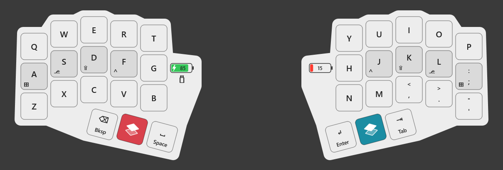

# OP36 Helper

> Development repository. Releases ship from the public mirror
> [yeroo/op36-helper](https://github.com/yeroo/op36-helper), produced by `tools/export-public.ps1`
> (fresh tree, no history, no vendor binaries). Tag `vX.Y.Z` there to publish a release.

A Windows tray app for the Ergohaven OmegaPoint36 split keyboard, plus a dual-role build of its RMK
firmware.

The helper draws a click-through overlay of your keyboard in the vendor's documentation style: the
layer you are holding, legends in the current Windows language (English and Russian), Shift / Ctrl /
Alt / Win variants, "find a key" when you press one on another keyboard, and the battery of each half.
The firmware lets **either half be the master**: the half holding the USB cable talks to the computer,
the other follows over the split link; with no cable the left half is the master over Bluetooth.



## Install

Download from the [latest release](https://github.com/yeroo/op36-helper/releases/latest):

- `op36-helper-setup-<version>.exe` installs for the current user (no admin rights), adds a Start
  Menu entry and, if you tick it, starts the helper with Windows. **Recommended.**
- `op36-helper-portable-<version>.exe` is the bare program; put it anywhere. To flash firmware from
  the portable exe, place the release's `op36_left.uf2`, `op36_right.uf2` and `BUILD_COMMIT.txt` in a
  `firmware` folder next to it.

The binaries are not code-signed, so Windows SmartScreen warns on first run: *More info → Run
anyway*. Every release carries a Sigstore build-provenance attestation; verify a download with
`gh attestation verify <file> --repo yeroo/op36-helper`.

## First run

The helper lives in the tray. Left-click the icon to show or hide the overlay, right-click for the
menu, double-click for **Options** (monitor, position, size, opacity, hotkey, theme, "reserve screen
space" so maximized windows stop above the overlay, start with Windows, update checks).

With the vendor's firmware the overlay already shows your keymap and language, but the layer, the
battery pictograms and the master glyph need the firmware below.

Switch the keyboard off and both halves grey out with *off*; after a minute the overlay hides
itself and gives the screen space back. Switch the keyboard on again and it comes back by itself.
Showing or hiding the overlay yourself in the meantime takes priority over that.

## Firmware

Options → **Firmware and updates** shows the build each half reports and the build bundled with this
helper. To flash a half:

1. Click **Flash left half…** (or right).
2. Double-tap the small reset button on the underside of that half. Its bootloader drive appears,
   the helper copies the right file, and the half restarts on the new firmware.
3. Repeat for the other half. Both halves must run the same build; the dialog says which one to do
   first and warns while they differ.

**Coming from the vendor's firmware (ZMK or stock RMK)** needs a one-time manual round, documented in
[firmware/FLASHING.md](firmware/FLASHING.md): pairing the halves again and re-pairing Bluetooth,
because the keyboard's name changes. After that the Flash buttons keep you current.

What the firmware adds: the cable picks the master; layer changes, battery levels (with a charging
bolt), the master side and link state are pushed to the helper live; your layout, combos and tap-hold
rules live in each half's own storage and survive updates.

## Layout

Configure keys with Ergohaven's Entropy or any Vial client, as the vendor documents. The helper reads
the layout from the keyboard. Because the storage is per half, write your layout to each half while it
is the master (cable in that half).

## Updates

The helper checks GitHub for a newer release once at start and every 12 hours (Options → *Check for
updates automatically*; turn it off for a fully offline helper). When one exists, a tray balloon says
so and Options offers **Update now**: the release is downloaded, its SHA-256 checked against the
digest GitHub publishes, the helper exits, installs it silently and relaunches. The portable exe is
swapped in place the same way.

## Files

| What | Where |
|---|---|
| Settings, keymap cache, log | `%APPDATA%\op36-helper\` |
| Program (installer) | `%LOCALAPPDATA%\Programs\OP36 Helper\` |
| Update downloads (temporary) | `%LOCALAPPDATA%\op36-helper\updates\` |

Uninstalling removes the program and its shortcuts and leaves your settings.

## Build from source

```
git clone --recurse-submodules https://github.com/yeroo/op36-helper
cd op36-helper/helper && cargo build --release        # the helper (Rust stable, Windows)
pwsh ../installer/build.ps1                           # the installer (Inno Setup 6)
bash ../firmware/tools/build-op36.sh                  # the firmware pair (ARM toolchain, see FLASHING.md)
```

Developer notes: [helper/README.md](helper/README.md), [firmware/FLASHING.md](firmware/FLASHING.md),
[installer/README.md](installer/README.md). The firmware source is the `rmk/` submodule
(`yeroo/rmk`, branch `op36-layer-notify`), pinned to the commit the bundled files were built from.

## License

MIT for everything in this repository except the `rmk/` submodule, which stays under RMK's
Apache-2.0. OmegaPoint36 and Entropy are Ergohaven's; this is an independent project.
